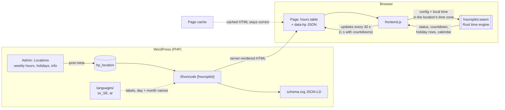

# HoursPilot

Business hours, holidays and a live open/closed badge for one or more locations.

| | |
|---|---|
| **Version** | 0.3.0 |
| **Requires** | WordPress 6.0+, PHP 7.4+ |
| **Tested up to** | WordPress 6.8 |
| **Author** | Arthur Sam Mahdi ([tsa3000](https://github.com/TSA3000)) |
| **Contributors** | tsa3000 |
| **Tags** | business hours, opening hours, holidays, schema, open now |
| **License** | GPL-2.0-or-later |

## Features

- Multiple locations, each with its own time zone
- Several opening hours per day (lunch breaks), "open 24 hours", hours past midnight
- Holidays and special hours (single days or date ranges), optionally repeating every year
- Countdown to opening / closing, calendar month view, vertical or horizontal layout
- Day names in the site language automatically, week start from *Settings → General*
- Live "Open now / Closed now" badge, computed in the browser by a small Rust/WebAssembly engine, so page caches never show a stale status
- schema.org `OpeningHoursSpecification` + `specialOpeningHoursSpecification` JSON-LD
- Works anywhere shortcodes do: block editor, Elementor, widgets
- Translated into Swedish and Arabic (right-to-left layout, optional Arabic-Indic digits ٠١٢…)

## Screenshots

Tuesday 16:35, 25 minutes before closing, with short holiday hours later in the week:

| English | Swedish | Arabic (`digits="arab"`) |
|---|---|---|
|  |  |  |

`layout="horizontal" holiday_hours="1"`


`layout="calendar"` (English and Arabic)

 

## Installation

Download `hourspilot-X.Y.Z.zip` from [Releases](https://github.com/TSA3000/hourspilot/releases) (not the "Source code" archives),
then *WordPress → Plugins → Add New → Upload Plugin*. Add locations under *Locations* in the admin menu.

## Shortcode

```
[hourspilot id="123"]
```

Omit `id` to use the first location.

| Attribute | Default | Description |
|---|---|---|
| `view` | `week` | `week` or `today` |
| `layout` | `vertical` | `vertical`, `horizontal` (one card per day) or `calendar` (month view, 12 months ahead) |
| `title` | *(empty)* | Empty = location name, `0` = no title |
| `group` | `1` | Merge consecutive days with identical hours |
| `short_days` | `0` | Short day names |
| `hide_closed` | `0` | Hide closed days |
| `hide_days` | | ISO day numbers to hide, e.g. `6,7` |
| `show_header` | `1` | Title, status badge and local time row |
| `show_status` | `1` | Open/closed badge |
| `show_local_time` | `0` | Current time at the location |
| `show_holidays` | `1` | List of upcoming holidays |
| `holiday_days` | `60` | How far ahead to list holidays |
| `date_format` | `j M` | PHP date format for holidays |
| `digits` | `latn` | `latn` (0–9) or `arab` (Arabic-Indic ٠–٩); site-wide default via the `hourspilot_digits` filter |
| `holiday_hours` | `0` | `1` = holiday hours replace this week's regular hours (turns off grouping) |
| `show_info` | `1` | Address, phone, e-mail, website, directions |
| `show_image` | `1` | Featured image |
| `schema` | `1` | schema.org JSON-LD |
| `accent` | | Accent colour, e.g. `#0f766e` |
| `open_countdown` | `0` | Countdown to the next opening while closed |
| `close_countdown` | `0` | Countdown to closing |
| `countdown_minutes` | `60` | Show the close countdown this long before closing |
| `countdown_format` | `{h}:{mm}:{ss}` | Tokens `{d}` `{h}` `{hh}` `{m}` `{mm}` `{s}` `{ss}`; without `{d}` hours keep counting past 24 |
| `open_countdown_text` | `Opening in [time]` | `[time]` = the countdown |
| `close_countdown_text` | `Closing in [time]` | |
| `open_text`, `closed_text`, `closed_label`, `open24_label`, `holiday_title` | *(translated)* | Labels |

## How it works



The server renders the hours once; everything that depends on *now* (open/closed, countdowns, today's holiday,
the calendar) is computed in the browser by the Rust engine. A cached page therefore never shows a stale status.

## Translations

English (source), Swedish (`sv_SE`) and Arabic (`ar`) ship in `languages/`: `.po` (editable), `.mo` (WordPress 6.0–6.4)
and `.l10n.php` (WordPress 6.5+). The site language (*Settings → General*) picks them automatically; day and month names
come from WordPress itself. Arabic gets a right-to-left layout through direction-neutral CSS.

To add a language: copy `languages/hourspilot.pot` to `hourspilot-<locale>.po`, translate it (e.g. with Poedit), then
compile with `wp i18n make-mo languages/ && wp i18n make-php languages/`. After changing texts in the code, refresh the
template with `wp i18n make-pot . languages/hourspilot.pot --exclude=rust,.github,languages` and
`wp i18n update-po languages/hourspilot.pot languages/`.

## Styling

Override CSS variables on `.hourspilot`:

`--hp-accent`, `--hp-open`, `--hp-soon`, `--hp-shut`, `--hp-line`, `--hp-radius`, `--hp-pad`

## Developers

Filters: `hourspilot_schema( array $data, int $location_id )`, `hourspilot_digits( string $system )` (`latn` | `arab`)

Data is stored as post meta on the `hp_location` post type:
`_hp_hours`, `_hp_holidays` (from, to, label, slots, recurring), `_hp_info`, `_hp_timezone`, `_hp_schema_type`.

Uninstalling the plugin does not delete your locations.

### Time engine

`rust/` (Rust, GPL-2.0-or-later) is compiled to `assets/hourspilot.wasm`; the compiler version is pinned in `rust/rust-toolchain.toml`.

```sh
cd rust
cargo test && cargo build --release --target wasm32-unknown-unknown
cp target/wasm32-unknown-unknown/release/hourspilot_core.wasm ../assets/hourspilot.wasm
```

### Releases

1. Bump `Version` and `HOURSPILOT_VERSION` in `hourspilot.php`, the version above, and add a `### X.Y.Z` entry under Changelog.
2. Commit, then `git tag -a vX.Y.Z -m "HoursPilot X.Y.Z" && git push origin master vX.Y.Z`.

`.github/workflows/release.yml` checks the versions, lints PHP 7.4 + 8.3, runs the Rust tests, builds the WebAssembly fresh
and publishes the installable zip as a GitHub release with this changelog entry as notes. Tags with a hyphen
(`v1.0.0-beta.1`) become pre-releases.

The zip gets a wordpress.org `readme.txt` generated from this file (`.github/scripts/readme-txt.py`); the **Contributors**
and **Tags** rows above exist for it.

## Changelog

### 0.3.0

- Swedish and Arabic translations; `.pot` template for more languages
- Right-to-left layout (direction-neutral CSS)
- Horizontal layout: 12-hour times wrap inside the day cards; local time without a leading zero
- README screenshots (English, Swedish, Arabic)
- `digits="arab"`: Arabic-Indic digits in times, dates, countdowns and the calendar
- Translatable list separator (Arabic "،")
- Translations load on `init` (no "loaded too early" notice on WordPress 6.7+)

### 0.2.0

- Time engine rewritten in Rust, compiled to WebAssembly (source in `rust/`)
- Recurring holidays ("Every year")
- Countdown to opening and closing (`open_countdown`, `close_countdown`)
- Calendar month view and horizontal layout (`layout="calendar|horizontal"`)
- Holiday hours can replace this week's regular hours (`holiday_hours="1"`)
- Opening times more than a week away are shown with their date

### 0.1.0

- First release
